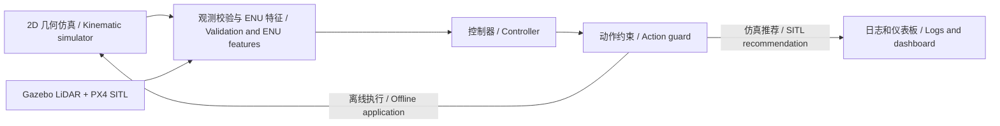

# 系统设计与实验解读 / System design and experiment interpretation

## 中文

### 两条运行路径

1. **离线实验。** 二维运动学环境以 0.1 秒为步长，用几何布局模拟 720 束水平测距。观测模块压缩测距并附加相对目标和当前水平速度。PPO、人工势场（APF）和直趋目标控制器使用相同的观测与动作约束。环境执行限幅后的动作，检查行进线段是否碰撞，并记录任务结果。
2. **仿真监测。** Gazebo 的水平 LiDAR 扫描经 ROS 2 桥接，PX4 SITL 的里程计和状态经 DDS 接入。监测节点检查扫描和里程计、统一坐标，并把 APF 推荐速度、传感器状态及运行指标写入日志。可通过本地仪表板查看。此路径是被动监测，PX4 独立管理飞行状态。

### 输入与动作约定

| 索引 | 输入 |
| --- | --- |
| 0–35 | 36 个各 10° 的 ENU 扇区最近量程，东向为第一个扇区，逆时针排列，按 6 m 归一化。 |
| 36–37 | 目标相对当前位置的东、北偏移，按 12 m 缩放并裁剪。 |
| 38–39 | 当前东、北速度，按 1 m/s 缩放并裁剪。 |

仿真监测要求完整的 360° 水平覆盖、对齐的局部坐标原点及合规的 PX4 NED 位置与速度。东、北分量互换并翻转竖直轴可把 NED 转换为 ENU。默认扫描和位姿最大接收年龄为 0.50 秒，最大接收时差为 0.25 秒，滚转和俯仰的绝对值上限为 15°。过期或覆盖不完整时，模块返回零速度推荐和原因。

动作是东、北方向的二维速度。正常情况下，速度模长不超过 1 m/s，速度变化率不超过 1 m/s²。当最近障碍距离不超过 0.55 m 时，模块直接推荐零速度。这个阈值由 0.20 m 机体半径和 0.35 m 余量组成。二维运动学环境可即时执行该停止动作。现实中的制动距离取决于机体动力学、执行延迟和传感器误差。

### 评价协议与结果

离线训练只向控制器提供观测向量。环境用几何真值生成测距和判定碰撞。奖励随朝目标前进而增加，扣除步进、速度变化和低净空惩罚。到达目标奖励 20，碰撞扣 20。进入目标半径 0.35 m 时判为成功，达到 240 步（24 秒仿真时间）时判为超时。

冻结训练、验证和测试布局。PPO 采用 CPU 上的两层 64 单元 MLP，在固定验证布局上以平均回报选择模型。三种控制器使用相同的测试布局。每个协议包含 60 个保留布局、5 条控制器配置（包括三条独立 PPO 训练种子）及 300 个测试回合。历史运行配置、按布局类型计数和耗时见 [归档指标](../examples/reference_metrics.json)。

| 配置 | 探索测试成功 | 确认测试成功 | 确认测试超时 |
| --- | ---: | ---: | ---: |
| APF | 48/60 | 48/60 | 12/60 |
| 直趋目标 | 24/60 | 24/60 | 36/60 |
| PPO，训练种子 0 | 7/60 | 45/60 | 15/60 |
| PPO，训练种子 1 | 0/60 | 47/60 | 13/60 |
| PPO，训练种子 2 | 0/60 | 42/60 | 18/60 |

两次历史运行共记录 600 个测试回合，均无碰撞。确认测试中 PPO 三个种子的平均成功率为 74.4%，范围为 70.0%–78.3%，APF 为 80.0%。所有配置在确认测试的 12 个 U 形陷阱布局中都超时。接近障碍时的共同停止规则可以使回合安全停止并最终超时。探索与确认阶段使用不同的保留布局及不同的训练步数，差异只适合描述这两次运行。

成功路径效率为“初始直线距离减目标半径”除以实际路径长度，只在成功回合计算。控制器延迟先取每回合推理时间的第 95 百分位，再取回合间中位数，计时范围为控制器决策。上述指标衡量静态布局中的二维运动学行为。训练收敛、运动障碍、Gazebo/PX4 闭环表现和实体飞行需单独验证。

## English

### Execution paths

1. **Offline benchmark.** A 2D kinematic simulator generates 720 horizontal range beams from the layout and advances in 0.1-second steps. The observation builder compresses the scan and appends the relative goal and measured horizontal velocity. PPO, the artificial potential field (APF) and the goal-seeking controller use the same observation and action constraints. The environment applies the guarded action, checks the swept path segment for collision, and records the outcome.
2. **Simulation monitor.** The ROS 2 bridge carries the Gazebo horizontal LiDAR scan, and DDS carries PX4 SITL odometry and vehicle status. The monitor validates the scan and pose, converts coordinate frames, and logs APF velocity recommendations, sensor state and run metrics. A local dashboard displays the monitor output. This is a passive integration path. PX4 manages the flight state independently.

### Observation and action contract

| Indices | Input |
| --- | --- |
| 0–35 | Nearest range in each of 36 ENU sectors of 10° each, starting east and increasing counterclockwise, scaled by 6 m. |
| 36–37 | Goal displacement east and north, scaled by 12 m and clipped. |
| 38–39 | Measured east and north velocity, scaled by 1 m/s and clipped. |

The monitor expects 360° horizontal scan coverage, aligned local origins, and PX4 local NED pose and velocity. Swapping the north and east components and reversing the vertical component converts NED to ENU. Defaults allow a scan or pose reception age of 0.50 s, a scan–pose reception skew of 0.25 s, and absolute roll and pitch up to 15°. Stale or incomplete observations produce a zero-velocity recommendation with a reason.

Actions contain east and north velocity. The normal limits are 1 m/s for speed and 1 m/s² for change in velocity. A range of 0.55 m or less immediately produces a zero-velocity recommendation. The threshold combines the 0.20 m vehicle radius and the 0.35 m margin. The kinematic model applies this stop instantly. Physical stopping distance depends on vehicle dynamics, actuation latency, and sensor error.

### Evaluation protocol and results

The offline controller receives the observation vector. The environment uses ground-truth geometry to generate scans and detect collisions. Reward increases with progress toward the goal and penalizes elapsed steps, velocity changes, and low clearance. Goal completion adds 20 and collision subtracts 20. A run succeeds within the 0.35 m goal radius and times out at 240 steps, equivalent to 24 seconds of simulated time.

The benchmark freezes train, validation and test layouts. PPO uses a two-layer MLP with 64 units per layer on the CPU, and checkpoint selection uses mean return on the fixed validation layouts. All controllers are evaluated on the same test layouts. Each protocol has 60 held-out layouts, five controller configurations including three independent PPO training seeds, and 300 test episodes. See the [archived metrics](../examples/reference_metrics.json) for the recorded settings, outcome counts by layout family, and decision timing.

| Configuration | Exploratory successes | Confirmation successes | Confirmation timeouts |
| --- | ---: | ---: | ---: |
| APF | 48/60 | 48/60 | 12/60 |
| Goal-seeking | 24/60 | 24/60 | 36/60 |
| PPO, training seed 0 | 7/60 | 45/60 | 15/60 |
| PPO, training seed 1 | 0/60 | 47/60 | 13/60 |
| PPO, training seed 2 | 0/60 | 42/60 | 18/60 |

The two archived runs recorded zero collisions across 600 test episodes. On the confirmation layouts, PPO averaged 74.4% success across seeds, with a range of 70.0% to 78.3%. APF achieved 80.0%. All configurations timed out on the 12 confirmation U-trap layouts. The shared proximity stop can end motion early and lead to a timeout. The two runs used different held-out layouts and training budgets, so the comparison is descriptive.

Path efficiency divides the initial straight-line distance minus the goal radius by the distance traveled, for successful episodes only. The timing metric is the median across episodes of each episode's 95th percentile controller decision time. These metrics describe 2D kinematic behavior on static layouts. Training convergence, moving obstacles, closed-loop Gazebo/PX4 performance, and physical flights require separate validation.

## Algorithm references / 算法参考

- PPO algorithm / PPO 算法. [Schulman et al. (2017)](https://arxiv.org/abs/1707.06347)
- APF baseline concept / 人工势场基线的理论来源. [Khatib (1986)](https://khatib.stanford.edu/publications/pdfs/Khatib_1986_IJRR.pdf)
- PPO library and API / PPO 训练库与接口. [Stable-Baselines3 2.5.0](https://stable-baselines3.readthedocs.io/en/v2.5.0/modules/ppo.html)
